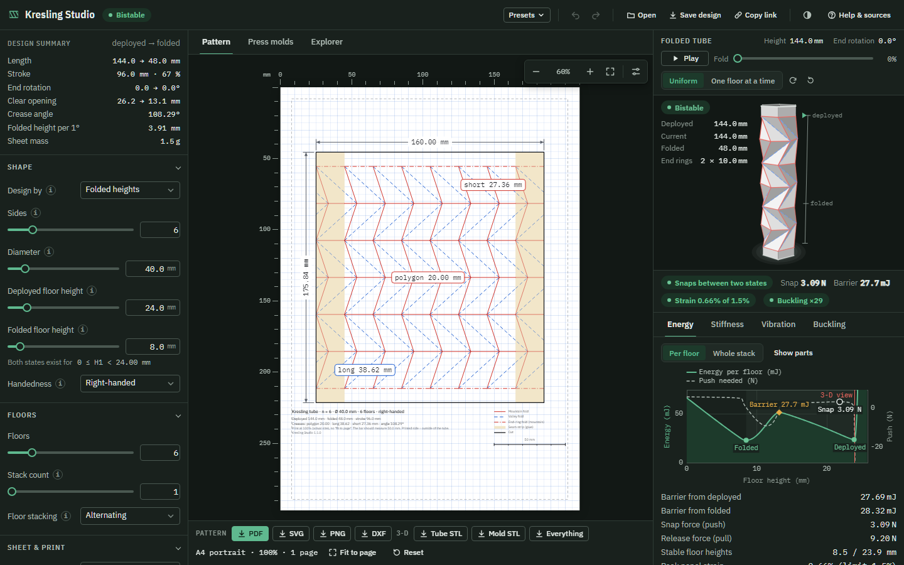

# Kresling Studio

Design Kresling origami tubes in the browser: an exact crease pattern you can print and
fold, a 3-D preview that folds the way the paper does, a mechanics model of the snap,
and the files to make it: PDF, SVG, PNG, DXF, an STL tube and STL embossing plates.

**Open the app:** [kreslinggen.vercel.app](https://kreslinggen.vercel.app) · no install, no account, nothing uploaded



> **About the name.** This repository is still called *Kresling-crease-Gen* after the
> first app that lived here, Kresling Crease Generator. The app was rebuilt from scratch
> around exact rigid-panel geometry and renamed **Kresling Studio**. The old app is in the
> git history; its last version (v25) is commit `fb4f988`.

## Contents

- [What it does](#what-it-does)
- [Quick start](#quick-start)
- [Using the app](#using-the-app) · [share links](#share-a-design) · [shortcuts](#keyboard-shortcuts) · [files](#files-it-makes)
- [How it works](#how-it-works)
- [Compared with Kresling Crease Generator](#compared-with-kresling-crease-generator-v24)
- [Development](#development) · [project layout](#project-layout)
- [References](#references) · [License](#license)

## What it does

- **Exact geometry.** Give the two floor heights you want, or the flat strip (height and
  crease angle); the app solves both rigid folded states in closed form and tells you
  whether the tube is bistable, monostable or cannot fold.
- **Printable pattern.** The whole tube on one sheet, with seam strips, end rings,
  dimension labels and a scale bar. Too big for the page? It tiles across pages with
  overlap, or fits to one page in a click.
- **3-D fold preview** with the same crease lengths as the print: fold it uniformly or one
  floor at a time, and play the snap.
- **Mechanics.** Energy and force along the fold (barrier, snap and release forces),
  stiffness, vibration modes with a payload, column buckling, and peak panel strain
  against the sheet's limit, for paper, card, Kapton, PET, PP or your own material.
- **Explorer.** Sweep any two parameters and see where the design is bistable, fits the
  page, survives buckling and stays below the strain limit.
- **Fabrication files.** Vector PDF, layered SVG, 300 dpi PNG, DXF for cutters, an STL of
  the tube, STL press molds for embossing the creases, and an "Everything" zip with
  folding instructions.
- **Works offline.** `dist/kresling.html` is the whole app in one file.

## Quick start

| | |
|---|---|
| **Online** | Open [kreslinggen.vercel.app](https://kreslinggen.vercel.app). |
| **Offline** | Download [`dist/kresling.html`](dist/kresling.html) and open it in a browser. It is self-contained, so it works from disk. |
| **From source** | Node 20 or newer, no `npm install` needed: `npm start`, then open http://localhost:8765/ |

## Using the app

1. **Start from an example.** *Presets* has ready designs; anything you save there stays
   in this browser.
2. **Shape the tube** in the left sidebar. The chip in the top bar says at once whether the
   design is bistable; an ⓘ next to a control explains it.
3. **Check it** on the right: the folded tube, the energy curve (click or drag on it to
   fold the 3-D view), stiffness, vibration and buckling.
4. **Lay out the sheet**: paper size, print scale (*Fit to page* or `F`), end rings and
   seam strips.
5. **Export** from the bar under the pattern, then print at 100 % ("actual size"); the
   scale bar on the sheet should measure 50 mm.

Your work is saved in the browser as you go. *Save design* writes a `.json` file; *Open*
reads it back, and so does dropping the file anywhere on the page. Presets exported by
Kresling Crease Generator open too (see [below](#how-it-works)). Undo and redo cover every
design change.

On a phone the sections stack, and a bar at the bottom jumps between
**Design · Pattern · 3-D · Analysis**. The theme button in the top bar switches between
following the system, light and dark.

### Share a design

*Copy link* (or `L`) copies a link that opens exactly this design, for example

```
https://kreslinggen.vercel.app/#v=1&n=8&dia=60&floors=4
```

The link lists only the values that differ from the standard design, so it stays short and
can be edited by hand. Opening it replaces the open design, and Undo brings yours back.
Links keep their meaning when later versions change a default. Copied from the offline
file, the link points to the online app.

### Keyboard shortcuts

| Keys | Action |
|---|---|
| `Ctrl Z` / `Ctrl Shift Z`, `Ctrl Y` (`⌘` on a Mac) | Undo / redo |
| `3` … `9` | Number of sides |
| `Space` | Play or stop the fold animation |
| `F` | Fit the pattern to one page |
| `P` / `S` | Save the pattern as PDF / SVG |
| `L` | Copy a link to this design |
| `T` | Switch the theme: system, light, dark |
| `?` | Help, shortcuts and sources |
| `Esc` | Close a dialog or menu |

### Files it makes

| Button | File | Scale |
|---|---|---|
| PDF | Vector PDF, one page or tiled pages with a legend | print scale |
| SVG | Layers: cut, mountain, valley, end ring, glue, info (one file per page when tiled) | print scale |
| PNG | 300 dpi image of the sheet | print scale |
| DXF | AutoCAD R12, mm, one layer per fold type, for cutters and CAD | print scale |
| Tube STL | The deployed tube as a closed, printable solid | design size |
| Mold STL | Mountain and valley embossing plates with a registration border (zip) | print scale |
| Everything | All of the above plus `design.json` and `README.txt` with folding steps (zip) | |
| Save design | `design.json`: the parameters, to open again later | |

Files are named after the design: `kresling_n6_d40_f6` is 6 sides, 40 mm across,
6 floors. A stack adds `x2`, a mirrored (left-handed) pattern adds `_left`, and files drawn
at a print scale other than 100 % add it (`_80pct`), so two prints of one design never
overwrite each other.

## How it works

**Geometry** (`js/core/kresling.js`). A floor joins two regular n-gons of circumradius R;
the top one is raised by H and twisted by φ. The flat strip has polygon side
a = 2R·sin(π/n) (the chord, not the arc), height h and shift s; its long and short diagonals
have lengths b² = s² + h² and c² = (s − a)² + h². Folding without stretching requires
b² = H² + 4R²sin²(φ/2) and c² = H² + 4R²sin²((φ − 2π/n)/2), which gives
sin(φ − π/n) = (2s − a)/(2R): exactly two rigid states whose twists add up to π + 2π/n
(Guest & Pellegrino 1994). The app solves these in closed form, so a design can be given
either as the two stable floor heights you want, or as the flat strip (height and crease angle).

**Mountain and valley** come from the dihedral angles of the real folded shape. With
the printed side outside: polygon rings and short diagonals are mountain folds, long
diagonals are valley folds (classic regime, crease angle above 90°).

**Pattern** (`js/core/pattern.js`). Alternating or same-handed floors, a true mirror for
left-handed tubes, and the sheet layout of Kresling Crease Generator: a straight seam with
glue strips on both sides (whole panels, or widths in mm) that carry copies of the creases
they are glued over, and plain end rings across the top and bottom of the sheet (set
separately, 0–60 mm each, 10 mm by default). The sheet holds the whole tube: floors × stack
count floors in one piece. Patterns that do not fit the page are tiled across several pages
with 10 mm overlap. When no pattern page has room for the legend and scale bar (a tiled
print, or a sheet that nearly fills its page), the PDF ends with a legend page.

**Print scale.** The printed sheet, the DXF and the press molds all follow the print
scale, so they stay one size; the 3-D printed tube (STL) stays at design size. The mold
plates carry a low border along the sheet outline for lining the sheet up, and their
ridge width is limited to 0.9 × the gap between neighbouring creases.

**Presets from Kresling Crease Generator.** *Open* reads the preset files the earlier app
exports and converts them (cm to mm, arc side to chord, entered angle to drawn angle) so
that every crease lands where that app prints it. Mountain and valley follow the folded
shape, as everywhere in this app, so some fold directions differ from that app's red and
green lines; the note shown on opening names them. Presets that have no rigid fold open
too, but this app draws no pattern for them and says why.

**Mechanics** (`js/physics/`). Each panel is a constant-strain triangle (plane-stress
St Venant–Kirchhoff, strain recovered exactly from its three side lengths). By default
panels are *thin*: compression beyond the plate-buckling strain kπ²t²/(12(1−ν²)w²) is
carried at constant stress, the way paper and film wrinkle. Creases are torsion springs
k = E·t³/(12(1−ν²)·w) per unit length (Filipov et al. 2015) with an adjustable rest
position between the deployed and folded shapes. The energy path relaxes the twist at
each height (ends free to rotate) and reports the wells, barrier, snap and release
forces, and peak panel strain against the sheet's limit. Vibration uses one floor with a
rigid top ring and payload, 6 degrees of freedom (in the style of Kidambi & Wang 2020).
Buckling fits a Timoshenko column to the lateral stiffness of one floor and compares the
Euler/Engesser load of the stack with the snap force.

**Limits.** Rings are rigid polygons, deformation is symmetric, and interior rings are
treated like rigid plates for buckling (so that load is an upper bound). Forces are
idealised; real creases vary with how sharply they are scored.

## Compared with Kresling Crease Generator v24

| | Kresling Crease Generator v24 | Kresling Studio |
|---|---|---|
| Polygon side | arc length πD/n (true tube 2.6–7 % wider than entered) | chord 2R·sin(π/n) |
| Stable states | criterion 1 < red/side < 1/sin(π/n) | both rigid states solved exactly |
| Ring folds | drawn as valley | mountain (from the folded shape) |
| Left-handed | switches the green diagonal (changes crease lengths) | true mirror image |
| 3-D view | flat strip height used as folded height | exact folded shape, same crease lengths as the print |
| Energy model | dihedral bending along an assumed path | panel stretch + buckling + crease hinges, relaxed twist |
| PDF | print dialog of an HTML page | real vector PDF, tiled across pages when needed |
| Stack count | floors × stack on one sheet | the same |
| Scale | sheet, DXF and molds | the same (the tube STL stays at design size) |
| Sharing | preset files | preset files, and links that open the design |

v25, the last version of that app (commit `fb4f988`), already takes the stable states from
the exact two-state solution, shows the true diameter, and draws the 3-D view and the energy
curve along the exact fold path; its creases, ring folds and left-handed pattern are as in v24.

Checking its presets with the exact solver: "Bistable n=6", "Monostable" and
"Compact unit" have no strain-free folded shape at all (for "Bistable n=6" the shift
exceeds the limit by 1.2 %), and "Bistable n=8" and "Tall tower" have a single stable state.

## Development

Plain HTML, CSS and JavaScript modules: no dependencies, no framework, no build step to
run the source. Node (20 or newer) is used only for the dev server, the bundler and the tests.

| Command | What it does |
|---|---|
| `npm start` | Serve the source at http://localhost:8765/ (`node tools/serve.mjs [port]`; ES modules need http) |
| `npm test` | Run every test file and print a summary; `npm test -- tube export` runs some, `--verbose` lists each test |
| `npm run build` | Bundle the app into `dist/kresling.html` (and `dist/artifact.html`, the same page without the document skeleton, for hosts that add their own) |
| `npm run samples` | Write every preset's exports to `samples/` and print a summary table |

Each test file also runs on its own: `node test/pattern.test.mjs`.

Before changing code, read [docs/ARCHITECTURE.md](docs/ARCHITECTURE.md): units and
coordinate frames, the module map, the design object, the physics and export APIs, the
view mount protocol and the rules every module follows (only the import forms the bundler
understands, no DOM access in `js/core`, `js/physics` and `js/export`, colours from CSS
tokens). Rebuild `dist/` after changing the source, since the offline file is committed.

### Project layout

```
index.html               page shell: loads css/*.css and js/main.js
css/
  app.css                tokens (light and dark), page grid, shared components
  flat.css view3d.css    one stylesheet per view: pattern, 3-D,
  panels.css explorer.css  analysis panel, explorer
js/
  main.js                boot: store, views, tabs, shortcuts, share links, file drop
  app/                   state and helpers, no drawing
    store.js             params with undo/redo, view state, memoised design/pattern/layout
    share.js             share links: the design in the URL hash
    util.js              DOM helper, formatting, storage, file names
  core/                  geometry and sheet layout (pure)
    kresling.js          exact rigid-panel geometry
    params.js            every control: schema, defaults, presets, materials, paper sizes
    design.js            params -> design (states, folds, lengths, warnings)
    pattern.js           design -> crease pattern of the whole sheet
    layout.js            page placement, fit and tiling
    tube.js mold.js      3-D tube mesh, press-mold ridges
    info.js              legend and info lines printed on the sheet
  physics/               mechanics (pure)
    mechanics.js         panel + hinge energy of one floor
    analysis.js          energy path, snap forces, strain check
    modal.js buckling.js sweeps.js explore.js
  render/                canvas views: flat (pattern), moldview, view3d, camera, chart
  ui/                    toolbar, controls (sidebar), actions (export bar), panels
                         (analysis), explorer, sources (help dialog), shortcuts, openfile
                         (open and drop), sectionnav (phone bar), toast, theme
  export/                svg, pdf, png, dxf, stl, json (design files), zip, save (pure)
test/                    node tests, one file per area (harness.mjs, no test framework)
tools/                   serve.mjs (dev server), build.mjs (bundler), test.mjs (runs
                         all tests), make-samples.mjs
dist/kresling.html       the whole app in one file (npm run build)
docs/
  ARCHITECTURE.md        how the code fits together, and its rules
  screenshot.png
```

## References

- Guest & Pellegrino (1994), The folding of triangulated cylinders, Part I. J. Appl. Mech. 61(4) 773–777. doi:10.1115/1.2901553
- Cai, Deng, Zhou, Feng & Tu (2015), Bistable behavior of the cylindrical origami structure with Kresling pattern. J. Mech. Des. 137(6) 061406. doi:10.1115/1.4030158
- Reid, Lechenault, Rica & Adda-Bedia (2017), Geometry and design of origami bellows with tunable response. Phys. Rev. E 95 013002. doi:10.1103/PhysRevE.95.013002
- Kidambi & Wang (2020), Dynamics of Kresling origami deployment. Phys. Rev. E 101 063003. doi:10.1103/PhysRevE.101.063003
- Filipov, Tachi & Paulino (2015), Origami tubes assembled into stiff, yet reconfigurable structures and metamaterials. PNAS 112(40) 12321–12326. doi:10.1073/pnas.1509465112
- Filipov, Liu, Tachi, Schenk & Paulino (2017), Bar and hinge models for scalable analysis of origami. Int. J. Solids Struct. 124 26–45. doi:10.1016/j.ijsolstr.2017.05.028
- Schenk & Guest (2011), Origami folding: a structural engineering approach. Origami 5, 291–304. doi:10.1201/b10971-27
- Timoshenko & Gere (1961), Theory of Elastic Stability, McGraw-Hill.
- DuPont Kapton HN technical data sheet.

## License

MIT, see [LICENSE](LICENSE).

---

> "Nothing is permanent except change." (attributed to Heraclitus)
>
> A Kresling tube holds two stable equilibria and no others; it doesn't hover
> in between. Every other configuration is transient, snapping toward one
> resting state or the other the moment you let go, which happens to be
> exactly what the energy curve in `js/physics/analysis.js` plots.

*(Vibecoded via Copilot in the beginning, now maintained by the lord Claude.)*
